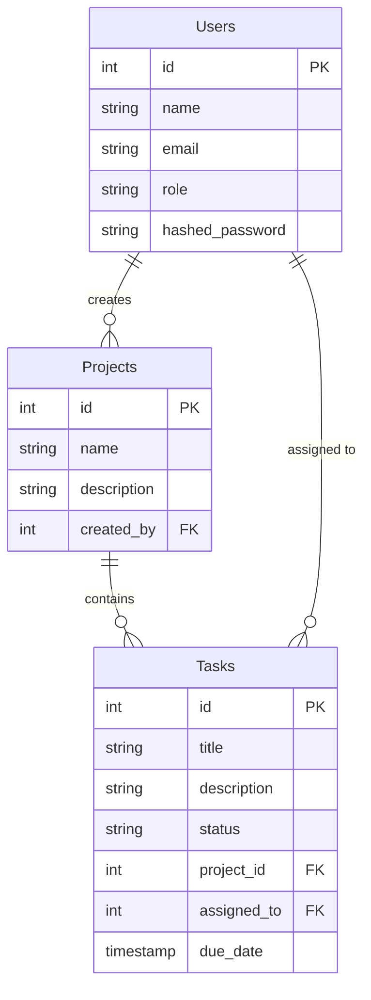

# Mini Project Management System

## Architecture Explanation
This repository follows a strict Layered Architecture approach implemented via FastAPI (Backend) and Next.js (Frontend).
1. **API Controllers (`app/api/`)**: Handlers strictly focused on HTTP parsing, request/response validation (via Pydantic), and managing HTTP status codes.
2. **Services / Business Logic**: Pydantic handles validation, while the endpoints act as thin controllers that execute logic concurrently via SQLAlchemy AsyncIO transactions.
3. **Database Repositories**: SQLAlchemy handles ORM abstraction (`app/models/`).
4. **Data Isolation**: Internal DB properties (`hashed_password`) are completely disjoint from outward-facing Data Transfer Objects (Pydantic `Response` models) to prevent leaks.

## ER Diagram

## Setup Steps

### Docker Setup (Bonus Points)
1. Run `docker-compose up --build -d` inside this directory.
2. The database, backend API, and frontend will boot automatically. Note: Wait for the database to boot before the backend can migrate.
3. Check the API at `http://localhost:8000/docs`.
4. Check the Frontend at `http://localhost:3000`.

### Manual Local Setup (Without Docker)
**Backend:**
1. Navigate to `/backend`.
2. Configure `.env` (`cp .env.example .env`). Set up a PostgreSQL database and update the credentials.
3. Turn on virtual env and install: `pip install -r requirements.txt`.
4. Run migrations: `alembic upgrade head`.
5. Start app: `uvicorn main:app --reload`.

**Frontend:**
1. Navigate to `/frontend`.
2. `npm install`
3. `npm run dev`

## API Documentation
The API documentation is dynamically generated using OpenAPI.
When the backend is running, navigate to [http://localhost:8000/docs](http://localhost:8000/docs) to access the interactive Swagger UI. This perfectly satisfies the "Swagger documentation" bonus point requirement. Allows you to test JWT Authentication and endpoint features out of the box.
